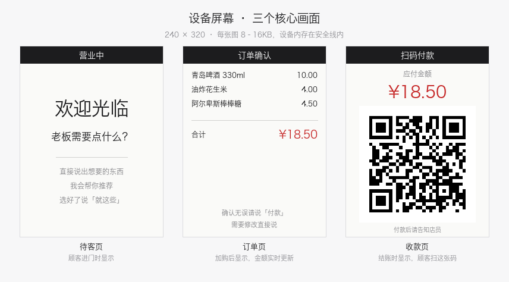

# AI 收银员 🤖🛒

基于 [小智 AI (xiaozhi-esp32)](https://github.com/78/xiaozhi-esp32) 硬件的全自动 AI 收银员：
**顾客走进店里，摄像头认出人来打招呼，顾客开口说要什么，AI 推荐商品、下单、屏幕出收款码、语音送客**——全程语音交互，无人工收银。



## 功能

- **摄像头迎宾**：本地人脸检测（不上传画面、不联网），顾客进店自动唤醒 AI 说欢迎语；喊一嗓子「有人在吗」也能唤醒
- **多人进出轮换**：顾客 30 秒没动静自动结束会话；未付款订单超时自动作废；屏幕自动切回待客页——上一单绝不污染下一单
- **语音导购**：AI 根据标签推荐商品（"给孩子带点什么""下酒的"），条码扫码查询报价
- **屏幕常驻显示**：订单确认页、收款二维码全屏常驻（服务端渲染 RGB565 原始帧推给设备，不走 LLM）
- **语音收款闭环**：顾客说"付好了" → 订单结清 → 屏幕回待客页 → 语音送客
- **后台管理**：商品/库存/多规格（整箱 vs 零售拆分价格库存）、商户收款码、服务话术（欢迎语/付款引导语/送客语）全部网页可配
- **对话式模拟测试**：不接真机也能全链路模拟 6 类迎宾防抖场景 + 真实 MCP 工具对话

## 架构

```
┌─────────────────┐   WebSocket(MCP)   ┌──────────────────┐
│  小智云端 LLM     │ ◄───────────────► │  Mac 本地服务      │
│  (对话/决策)      │                    │  ├ MCP 收银工具    │
└────────┬────────┘                    │  ├ 商户后台 :8800  │
         │ 音频流                        │  └ 屏幕服务 :8801  │
┌────────┴────────┐   HTTP 轮询(1.5s)   └────────┬─────────┘
│  ESP32-S3 设备   │ ◄───────────────────────────┘
│  ├ 人脸检测迎宾   │   RGB565 原始帧全屏常驻显示
│  ├ 能量 VAD      │
│  └ 屏幕轮询显示   │
└─────────────────┘
```

关键设计：**屏幕显示的控制权不交给 LLM**。小智的 `preview_image` 是 user-only
工具（云端模型看不到调不了）且 5 秒自动隐藏，所以改为「MCP 工具在服务端登记
画面 → 设备固件轮询拉原始帧常驻显示」，收款码稳稳挂到顾客付款为止。

## 硬件

- ESP32-S3 开发板（**bread-compact-wifi-s3cam**：OV3660 摄像头 + 240x320 ST7789 屏 + 麦克风喇叭）
- 一台 Mac/Linux/Windows 跑本地服务（Python 3.10+）
- 与设备同一局域网

## 快速开始

### 1. 后端

```bash
git clone https://github.com/opc007/ai-cashier.git
cd ai-cashier
pip3 install fastapi uvicorn mcp pillow qrcode numpy pyserial

# 初始化演示数据（商品/标签/商户）
python3 -m app.seed

# 配置小智 MCP 接入点（控制台 → 智能体 → MCP 接入点）
cp .env.example .env && vi .env

# 启动商户后台 :8800
python3 -m app.admin
# 启动桥接（MCP 收银工具 + 屏幕服务 :8801）
./run_bridge.sh
```

### 2. 固件

见 [firmware_patches/README.md](firmware_patches/README.md)——基于 xiaozhi-esp32 v2.5.2 的补丁覆盖层，
覆盖 `main/` 后正常编译烧录即可。设备屏幕服务地址可用 NVS `cashier/server_url` 覆盖。

### 3. 角色设定

把 [prompts/cashier_role.txt](prompts/cashier_role.txt) 粘贴到小智控制台的角色设定，
它定义了收银员的接待流程、铁律（不许编价格）和多人轮换的规矩。

## MCP 工具一览

| 工具 | 作用 |
|---|---|
| `search_products` | 按名称/标签/口味模糊搜商品（搜"可乐"不会返回"小布丁"） |
| `lookup_barcode` | 条码查价 |
| `add_to_order` / `remove_from_order` / `change_quantity` | 加删改购物车（支持多规格） |
| `show_order_screen` | 订单上屏 |
| `checkout` | 确认订单，屏幕出收款码（常驻） |
| `mark_paid` | 顾客付款后结单、切待客页、拿送客语 |
| `end_service` | 顾客没买就走：作废订单、切待客页 |
| `get_service_scripts` | 取后台预设话术 |

## 免责声明

本项目用于**学习和个人店铺实验**。收款二维码由商户自行上传，本系统不做支付
通道对接、不处理任何资金；AI 有说错价格/推荐失当的可能，正式商用请自行评估
并保留人工核对环节。

## License

MIT
